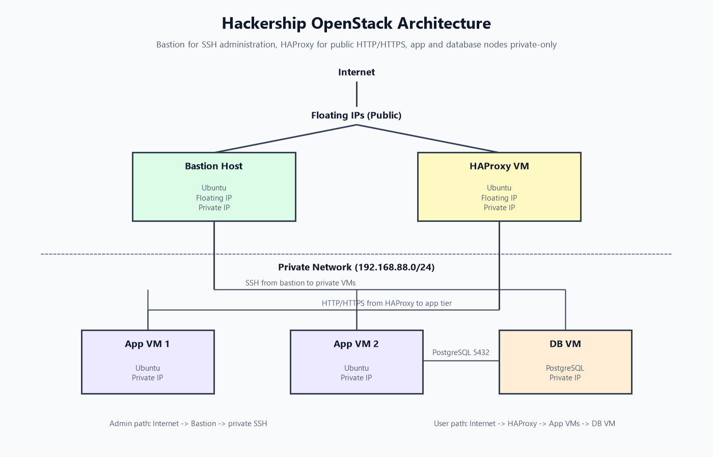

# Hackership — IaC Repo (Pulumi + Ansible, HA on OpenStack)

Deploy a highly-available Hackership instance on OpenStack (FelCloud): a load
balancer in front of two identical application nodes, backed by a dedicated
PostgreSQL database node. Losing one application node does not interrupt
service.



## Repo structure

```
hackership-iac/
├── README.md                          # Quick-start guide
├── docs/
│   ├── architecture.md                # HA topology, components
│   ├── deployment-guide.md            # Step-by-step deployment
│   ├── import-existing-infrastructure.md # Existing infrastructure import guide
│   ├── operations-guide.md            # Common tasks
│   ├── troubleshooting-guide.md       # Issues + solutions
│   └── architecture-diagram.png       # Visual topology
├── infra/                             # Pulumi IaC
│   ├── Pulumi.yaml                    # Project config
│   ├── Pulumi.dev.yaml                # Dev Stack config
│   ├── __main__.py                    # Main Pulumi exports & imports
│   ├── network.py                     # Network lookups (hackership)
│   ├── compute.py                     # Compute VMs (bastion, app-vm-1/2, db-vm)
│   ├── storage.py                     # Persistent volume resources
│   ├── security.py                    # Security group resources
│   ├── floating_ips.py                # Floating IP allocations & assignments
│   └── .gitignore
├── ansible/                           # Ansible (Person 3)
│   ├── inventory.ini                  # Host inventory (or generated from Pulumi)
│   ├── site.yml                       # Main playbook
│   ├── roles/
│   │   ├── base/
│   │   │   ├── tasks/main.yml
│   │   │   ├── templates/
│   │   │   └── handlers/main.yml
│   │   ├── hackership\_app/
│   │   │   ├── tasks/main.yml
│   │   │   ├── templates/
│   │   │   └── vars/main.yml
│   │   ├── reverse\_proxy/
│   │   │   ├── tasks/main.yml
│   │   │   └── templates/
│   │   └── security/
│   │       ├── tasks/main.yml
│   │       └── templates/
│   └── .gitignore
├── scripts/
│   ├── deploy.sh                      # Wrapper: pulumi up + ansible-playbook
│   ├── test-ha.sh                     # HA failover test script (Person 4)
│   └── cleanup.sh                     # pulumi destroy wrapper
└── .gitignore                         # Secrets, state files, credentials
```


## Prerequisites

- Python 3.10+ and `pip`
- [Pulumi CLI](https://www.pulumi.com/docs/install/)
- Ansible (`pip install ansible`)
- An OpenStack (FelCloud) account and project, with an SSH key pair imported
- **WSL users:** clone this repo and create your virtualenv on the native
  Linux filesystem (`~/...`), not under `/mnt/c/...` — see
  `docs/troubleshooting-guide.md` for why.

## Environment variables

Create a `felcloud-env.sh` (kept out of git via `.gitignore`) with your
OpenStack credentials. Application credentials are recommended over a raw
password for anything automated:

```bash
export OS_AUTH_URL=https://identity.api.felcloud.io/v3
export OS_IDENTITY_API_VERSION=3
export OS_AUTH_TYPE=v3applicationcredential
export OS_APPLICATION_CREDENTIAL_ID="<your_credential_id>"
export OS_APPLICATION_CREDENTIAL_SECRET="<your_credential_secret>"
```

Full explanation of how to generate these, and the password-based
alternative, is in `docs/deployment-guide.md`.

## Quick start

```bash
# 1. Environment
python3 -m venv venv
source venv/bin/activate
pip install --upgrade pip
pip install pulumi pulumi-openstack

# 2. Credentials
source felcloud-env.sh
openstack server list   # sanity check — should return without an auth error

# 3. Provision infrastructure
cd infra
pulumi stack select dev
pulumi preview
pulumi up

# 4. Configure and start the app
cd ../ansible
ansible-playbook -i inventory/ site.yml

# 5. Verify
curl http://<lb_floating_ip>/
```

See `docs/deployment-guide.md` for the full walkthrough, including LB health
monitor configuration and the destroy/up reproducibility test.

> **Existing Infrastructure Adoption**: To bring existing live OpenStack VMs, volumes, and floating IPs under Pulumi management without recreate/destroy operations, see [docs/import-existing-infrastructure.md](docs/import-existing-infrastructure.md).

## Common tasks

- **Scale up/add a node, rotate credentials, back up the database, roll back
  a deploy, simulate a node failure** → `docs/operations-guide.md`
- **Something's broken** → `docs/troubleshooting-guide.md`
- **Understand the "why" behind the design** → `docs/architecture.md`

## Security notes

- No credentials are committed to this repo — `.gitignore` excludes
  `felcloud-env.sh`, `venv/`, and any `.env` files.
- Security groups follow least privilege: only the load balancer accepts
  public traffic; the app tier only accepts traffic from the LB; the
  database only accepts traffic from the app tier.
