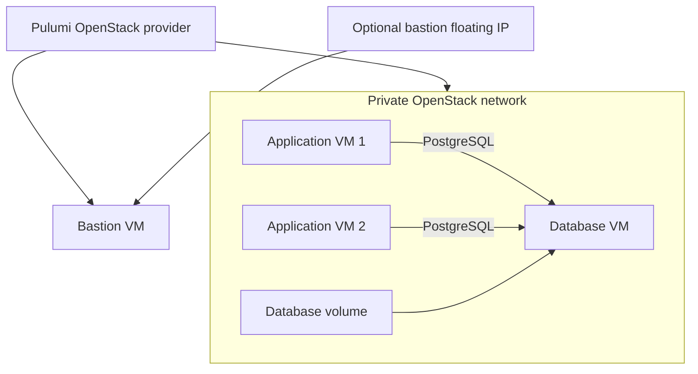

# Hackership OpenStack Infrastructure

Pulumi infrastructure code for a Hackership application lab on OpenStack/FelCloud. The current public branch provisions a private network and subnet, security groups, two application VMs, a database VM with a storage volume, and a bastion host with optional floating-IP configuration.

## Current architecture



The repository documents a high-availability target, but the current Pulumi source does not provision a load balancer or health-check pool. The existing `docs/architecture-diagram.png` depicts that target architecture and should not be read as proof that the load balancer is implemented. The current public branch also has no Ansible playbooks, although some deployment documentation refers to an Ansible handoff. It therefore does not provide a complete, reproducible end-to-end HA deployment from this checkout.

## Stack

- Python and Pulumi
- Pulumi OpenStack provider
- OpenStack networking, security groups, compute instances, and block storage
- Cloud-init for instance bootstrap

## Repository layout

```text
infra/       Pulumi stack and OpenStack resource definitions
docs/        Architecture, deployment, infrastructure, operations, and troubleshooting notes
```

## Provisioning

Prerequisites: Python, Pulumi CLI, an OpenStack project, and an imported SSH key pair. Configure OpenStack authentication in your local shell or application-credential environment; do not commit credentials or Pulumi state files.

```bash
cd infra
python3 -m venv .venv
source .venv/bin/activate
python -m pip install -r requirements.txt
pulumi stack init dev  # Use pulumi stack select dev if the stack already exists.
pulumi config set keypair "YOUR_IMPORTED_KEYPAIR_NAME"
pulumi preview
pulumi up
```

This command provisions the resources defined in the Pulumi stack. It does not configure the application through Ansible or create the load balancer shown in the target diagram. Review `docs/deployment-guide.md` and `docs/infra.md` for the project notes and their current implementation boundaries.

## Security and validation notes

- Keep OpenStack credentials in environment variables or an external secret store.
- Review security-group rules and exposed floating IPs before deploying to a shared project.
- The repository contains no verified HA failover benchmark or current deployment evidence. Do not interpret the target architecture or documentation as a production availability claim.
